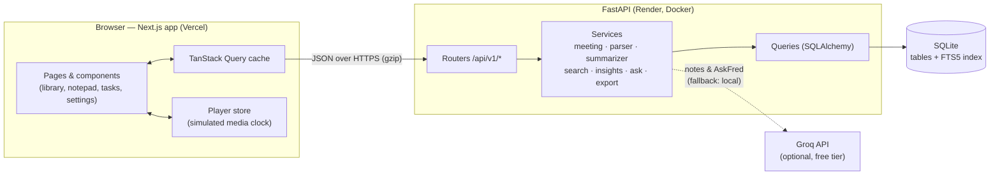
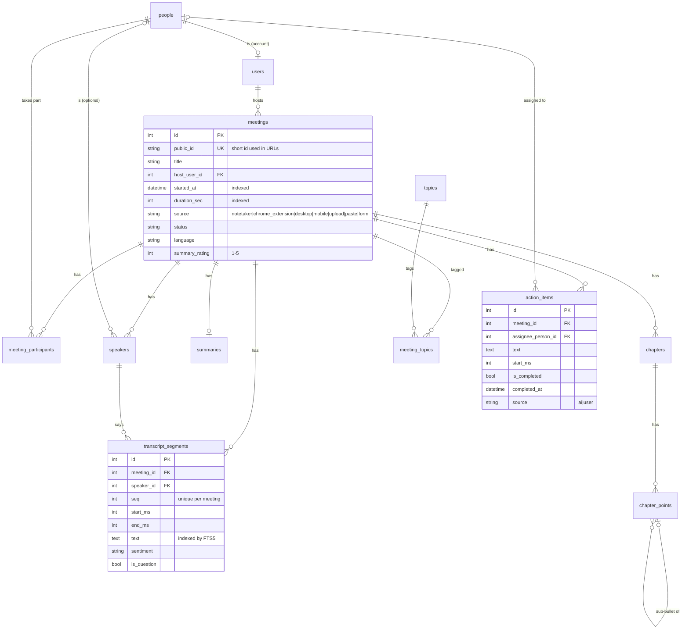

# Fireflies.ai Clone — Meeting Notes & Transcription Platform

A functional clone of the [Fireflies.ai](https://fireflies.ai) meeting-assistant web app. It recreates
the Fireflies workspace — the meetings library, the meeting "notepad" with an interactive transcript
synced to a media player, AI notes (keywords, overview, chapters, action items), Smart Search,
AskFred, global search and tasks — on top of a FastAPI + SQLite backend.

- **Live demo:** https://fireflies-clone-alpha.vercel.app
- **Repository:** https://github.com/Tashu020/Fireflies-Clone

> Real speech-to-text and live meeting bots are out of scope (per the brief). Meetings come from
> seeded data or from transcripts you upload / paste (`.txt`, `.vtt`, `.srt`, `.json`). Notes and
> AskFred answers are written by an LLM (**Groq**, free tier) when a key is configured, with a
> built-in summarizer as an automatic fallback. The whole stack runs on free tiers ($0).

---

## Contents
1. [Features](#features)
2. [Tech stack](#tech-stack)
3. [Getting started](#getting-started)
4. [Architecture](#architecture)
5. [Database schema](#database-schema)
6. [API overview](#api-overview)
7. [How the key pieces work](#how-the-key-pieces-work)
8. [Testing & performance](#testing--performance)
9. [Assumptions & limitations](#assumptions--limitations)
10. [Deployment](#deployment)

---

## Features

### Core (assignment "must haves")
| Area | What's implemented |
|---|---|
| **Meetings library** | Meetings grouped by day (Today / Yesterday / date) with title, time, duration, participant avatars and capture source · search by title **or transcript keyword** · Fireflies-style two-pane **Filters** popover: Hosted by, Participants, Date range (Any time / Today / Last 7·14·30 days / custom), Duration buckets, Captured from, Topics · removable filter chips · Hosted / Shared quick filters · channels (My Meetings, All Meetings, Uploads) · newest/oldest sort · infinite scroll · filters kept in the URL |
| **Meeting notepad** | Interactive transcript with speaker avatars, names and timestamps · player bar with seek bar (click/drag), ±15 s, playback speed · **click any sentence/timestamp → player seeks**, and **playback → current sentence highlighted + auto-scroll** (with "resume auto-scroll") · **Find in transcript** with highlighted matches, `n/N` counter, next/previous (Enter / Shift+Enter, `Ctrl+F`) · deep links (`?t=seconds`, `?q=term`) |
| **AI notes** | Written by an LLM via Groq (or the built-in summarizer): keywords · overview · notes chapters (bold points with clickable timestamps + sub-bullets) · outline index · action items grouped by assignee · copy summary as Markdown · regenerate notes |
| **CRUD** | Create a meeting by **uploading** a transcript file, **pasting** text, or a **form** · edit title, date and participants · rename · delete (with confirmation, single or bulk) · add / edit / complete / reassign / delete action items · everything persists in SQLite |
| **Fireflies experience** | Collapsible icon nav rail, top bar with search (`Ctrl+K`), Upgrade pill, notifications, **Capture ▾** menu, profile menu · Fireflies design tokens (purple `#6938EF`, DM Sans + Inter, gray scale, radii, shadows) · modals, popovers, toasts, skeletons, empty states · Settings pages · "Coming Soon" placeholders |

### Also implemented (bonus + Fireflies fidelity)
- **Global search** across all meetings (titles + full-text transcript search with highlighted snippets that open the meeting at the right moment).
- **AskFred** (LLM-powered) for a meeting — answers questions from the notes and transcript, with clickable cited excerpts.
- **Smart Search** panel — AI filters (Questions, Tasks, Dates & times, Metrics), sentiment split, speaker talk time & words per minute, topic trackers; selecting one filters the transcript.
- **Export** transcript / notes as **TXT** or **Markdown**, and notes as **PDF** via a print-optimised layout.
- **Tags / topics** — keywords are stored as topics; filter the library by them or click a keyword chip.
- **Tasks** page — every action item across meetings (My Tasks / All Tasks, open / completed).
- **Transcript editing** — fix a sentence or rename a speaker (search index updates automatically).
- **Dark mode** — Light / Dark / System, using Fireflies' dark palette.
- Home page (welcome, quick start, recent meetings), Uploads page, responsive layout (notepad switches to tabs on small screens).

### Placeholders ("Coming Soon")
Live meeting bot (Add to live meeting / Schedule / Start recording), real speech-to-text, integrations
(Zoom, Meet, calendar, Slack, CRM), team / sharing / channels, authentication, AI Skills, Analytics,
Voice Agents, Upgrade, Soundbites, Comments and Bookmarks.

---

## Tech stack

| Layer | Technology |
|---|---|
| Frontend | **Next.js 14** (App Router) · **TypeScript** (strict) · Tailwind CSS (design tokens as CSS variables) · TanStack Query · TanStack Virtual · Radix UI primitives · lucide-react icons · sonner toasts |
| Backend | **Python 3.12** · **FastAPI** · SQLAlchemy 2 · Pydantic 2 · Uvicorn |
| AI | **Groq** API (`openai/gpt-oss-120b`, free tier, JSON mode) — optional, with local fallback |
| Database | **SQLite** (WAL mode, foreign keys on) with an **FTS5** full-text index |
| Testing / quality | pytest (70 API & unit tests) · Ruff · ESLint · `tsc --noEmit` |
| Hosting | Vercel Hobby (frontend) · Render Free (backend, Docker) — **$0 total** |

---

## Getting started

Prerequisites: **Python 3.11+** and **Node.js 18.17+**.

### 1. Backend (http://localhost:8000)
```bash
cd backend
python -m venv .venv
# macOS/Linux: source .venv/bin/activate      Windows: .venv\Scripts\activate
pip install -r requirements-dev.txt
# only if backend/.env doesn't exist yet (it holds the optional Groq key):
cp .env.example .env
uvicorn app.main:app --reload --port 8000
```
On first start the database is created and **seeded automatically** with 9 demo meetings (full
transcripts, notes and action items). Interactive API docs: http://localhost:8000/docs

Reset the demo data at any time: `python -m app.seed --reset`

### 2. Frontend (http://localhost:3000)
```bash
cd frontend
npm install
cp .env.example .env.local      # NEXT_PUBLIC_API_URL=http://localhost:8000/api/v1
npm run dev
```

### Checks
```bash
cd backend && pytest && ruff check .
cd frontend && npm run lint && npm run typecheck && npm run build
```

### Environment variables
| Variable | Where | Default | Purpose |
|---|---|---|---|
| `DATABASE_URL` | backend | `sqlite:///./app.db` | SQLite file location (`sqlite:////data/app.db` in production) |
| `CORS_ORIGINS` | backend | `http://localhost:3000` | Comma-separated allowed frontend origins |
| `SEED_ON_STARTUP` | backend | `true` | Seed demo meetings when the database is empty |
| `GROQ_API_KEY` | backend | *(empty)* | Optional free key from [console.groq.com](https://console.groq.com/keys); empty = built-in summarizer |
| `GROQ_MODEL` | backend | `openai/gpt-oss-120b` | Groq model used for notes and AskFred |
| `NEXT_PUBLIC_API_URL` | frontend | `http://localhost:8000/api/v1` | Backend base URL |

Sample transcripts for trying the upload flow are in [`backend/tests/fixtures/`](backend/tests/fixtures/)
(`.txt`, `.vtt`, `.srt`, `.json`).

---

## Architecture



**Backend layering** — `api/` (routers: HTTP only, validation via Pydantic schemas) → `services/`
(use cases; each write is one transaction) → `models/` (SQLAlchemy). Read queries live in
`services/meeting_queries.py`; writes in `services/meeting_service.py`. Errors are domain exceptions
mapped to HTTP codes in one place (`core/errors.py`).

**Frontend structure** — `app/` holds routes only; features live in `features/<area>/` (`meetings`,
`notepad`, `transcript`, `player`, `tasks`, `settings`, ...) with their own components and data hooks;
shared UI primitives are in `components/ui`; the app shell in `components/layout`. Server state is
cached by TanStack Query (optimistic updates for action items); there is no global client store.

```
backend/
  app/
    api/v1/            routers: meetings, action_items, search, people, health
    core/              settings, error handling
    db/                engine (SQLite pragmas), FTS5 DDL, custom UTC datetime type
    models/            SQLAlchemy models
    schemas/           Pydantic request/response models
    services/          parser, transcript builder, summarizer, queries, writes, search, insights, ask, export
    seed/              fixtures (data/*.json) + loader
  tests/               pytest suite + sample transcript fixtures
frontend/src/
  app/                 routes: / (Home), /meetings, /view/[slug], /tasks, /upload, /settings/[section], placeholders
  components/          ui primitives, layout (nav rail, top bar, search, menus), providers
  features/            meetings, notepad, transcript, player, action-items, tasks, home, settings, workspace
  lib/                 API client, types, formatting, routes, query keys, hooks
  styles/tokens.css    Fireflies design tokens (light + dark)
```

---

## Database schema



| Table | Purpose |
|---|---|
| `people` | Everyone who appears in meetings (participants, speakers, assignees). Unique email when known. |
| `users` | Workspace accounts (can host meetings); 1:1 with a `people` row. The app runs as one default user. |
| `meetings` | Meeting metadata. `public_id` keeps URLs short and non-sequential. |
| `meeting_participants` | Many-to-many meetings ↔ people, with `role` (host/attendee), `attended` and display order. |
| `speakers` | Speaker labels within one transcript, optionally linked to a person (a label like "Speaker 1" may not be a known contact). |
| `transcript_segments` | **One row per sentence** with start/end times — enables precise seek, highlight and search. |
| `transcript_fts` | FTS5 *external-content* index over `transcript_segments.text` (porter stemming), kept in sync by triggers. |
| `summaries` | 1:1 AI summary (overview, gist, generator). Regenerating replaces it. |
| `chapters` / `chapter_points` | The notes outline; points reference a parent for sub-bullets. |
| `topics` / `meeting_topics` | Keywords as shared, filterable tags (ranked per meeting). |
| `action_items` | Tasks with optional assignee and timestamp; `source` separates AI-extracted from user-added (user items survive regeneration). |
| `comments` / `soundbites` | Schema reserved for collaboration features (UI is "Coming Soon"). |

Design choices: all child rows use `ON DELETE CASCADE`, so deleting a meeting is a single statement
(the FTS index is cleaned up by triggers); timestamps are stored as UTC and returned as ISO-8601 with
`Z`; check constraints guard enum-like columns; composite indexes back every list filter
(`started_at`, `(host_user_id, started_at)`, `source`, `duration_sec`, `(meeting_id, start_ms)`, ...).
The schema is created by `Base.metadata.create_all` + the FTS DDL at startup (no migration tool is
needed for this assignment; switching `DATABASE_URL` to Postgres would need only the FTS piece
replaced).

---

## API overview

All endpoints are under `/api/v1` (full OpenAPI docs at `/docs`). Errors return `{"detail": "..."}`
with 404 / 409 / 413 / 422 as appropriate.

| Method | Path | Description |
|---|---|---|
| GET | `/health` | Liveness + database check |
| GET | `/me` · `/users` · `/people?q=` · `/topics` | Current (default) user, workspace hosts, people autocomplete, tags with counts |
| GET | `/meetings` | Paginated list. Filters: `q` (title or transcript), `channel` (`mine`/`all`/`uploads`), `quick` (`hosted`/`shared`), `host`, `participant`, `source`, `duration` (`lt15`…`gt90`), `topic`, `date_from`, `date_to`, `sort`, `limit`, `offset` |
| POST | `/meetings` | Create from pasted transcript text or form fields |
| POST | `/meetings/upload` | Create from a `.txt` / `.vtt` / `.srt` / `.json` file (multipart, ≤ 5 MB) |
| GET · PATCH · DELETE | `/meetings/{id}` | Detail (participants, speakers, summary, chapters, action items) · update title/date/participants/rating · delete |
| GET | `/meetings/{id}/transcript` | All sentences + speakers (served separately so lists and detail stay light) |
| PATCH | `/meetings/{id}/speakers/{speaker_id}` · `/meetings/{id}/segments/{segment_id}` | Rename a speaker · edit a sentence |
| POST | `/meetings/{id}/summary/regenerate` | Re-run the summarizer (keeps user-added action items) |
| GET | `/meetings/{id}/insights` | Smart Search data (AI filters, sentiment, talk time, topics) |
| POST | `/meetings/{id}/ask` | AskFred question → answer + cited transcript excerpts |
| GET | `/meetings/{id}/export?format=txt\|md&content=transcript\|summary\|all` | Download |
| GET · POST | `/meetings/{id}/action-items` | List / add action items |
| PATCH · DELETE | `/action-items/{id}` | Edit text, assignee, timestamp or completion · delete |
| GET | `/action-items?scope=mine\|all&status=open\|done\|all` | Tasks across meetings |
| GET | `/search?q=` | Global search: title matches + ranked transcript snippets |

---

## How the key pieces work

**Transcript ↔ player sync.** Recordings are out of scope, so the player is a simulated media clock
(`features/player/player-store.ts`): a `requestAnimationFrame` loop advances time × playback rate.
It lives outside React state; components subscribe with `useSyncExternalStore` and selectors, so
while playing only the clock, seek bar and the *index of the active sentence* re-render — found by
binary search over sentence start times. The transcript list is virtualized (TanStack Virtual) and
scrolls to the active block; an explicit seek from anywhere (notes timestamp, search result, action
item) bumps a `seekVersion` so the transcript re-centres.

**Transcript parsing.** `services/transcript_parser.py` normalizes every format to
`(speaker, start?, end?, text)` utterances: `.txt` / pasted text (`[00:01:23] Name: text`,
`Name (01:23): text`, `Name: text`, or Fireflies/Zoom-style `Name  00:12` header lines), WebVTT
(`<v Name>` voice tags or `Name:`), SRT, and JSON (`[{speaker, start, end, text}]` in seconds or ms).
`services/transcript_builder.py` splits utterances into sentences and assigns times; missing times
are estimated at ~150 words per minute.

**AI notes (Groq).** When `GROQ_API_KEY` is set, `services/llm_summarizer.py` sends the transcript
as numbered lines (`[12] 03:05 Ann Lee: …`) to Groq in JSON mode and asks for Fireflies-style notes
that refer back to line numbers. The response is validated before it's saved: line numbers become
exact sentence timestamps, unknown lines are dropped, assignees must be real speakers, and
incomplete notes are rejected. Long meetings are sampled evenly to fit the free tier's token limit.
`services/groq_client.py` is a ~70-line standard-library client; **any** failure (no key, network
error, rate limit, bad JSON) raises `LLMError` and the app falls back to the built-in summarizer,
so the feature can never break the app. The generator used is stored (`summaries.generator`).
Tests mock Groq, so they stay offline and free.

**Built-in summarizer (fallback).** `services/summarizer.py` is an extractive summarizer with no external dependency:
keywords are frequent two-word phrases and words (stop-words removed); the transcript is split into
chapters at speaker changes, titled by terms distinctive to each chapter (TF-IDF across chapters);
the highest-scoring sentences become the overview and chapter bullets; action items are sentences
with commitment/request cues ("I'll…", "can you…", "let's…") rewritten as imperatives, with the
assignee taken from the speaker or the person addressed. Seeded meetings use hand-written notes
whose timestamps are resolved from quoted transcript snippets, so every timestamp is exact.

**Search.** The library `q` filter matches titles (`LIKE`) or transcripts (FTS5, every word,
prefix-matched). Global search ranks transcript hits with FTS5 BM25 and returns `snippet()`
excerpts; user input is quoted token by token, so FTS operators can't be injected.

**Smart Search & AskFred.** Insights are computed per request from the sentences: questions
(`?`), tasks (action cues), dates/times and metrics (regex), sentiment (small lexicon with
negation), and talk time / WPM per speaker. AskFred sends Groq the meeting notes plus the
transcript (for long meetings, the sentences most relevant to the question) and asks for an answer
with the supporting line numbers, which become clickable citations. Without Groq, it answers common
intents (action items, summary, decisions, attendees, questions) from the notes and otherwise ranks
sentences by IDF-weighted keyword overlap.

---

## Testing & performance

`pytest` runs 70 tests against a fresh copy of the seeded database for every test: all endpoints
(happy paths, validation, 404/409/413/422), every upload format, filters and pagination, cascade
deletes and FTS sync, the parser, the summarizer, AskFred, and the Groq integration (with Groq
mocked: valid notes, malformed notes, and fallback on failure). Frontend quality gates are
`tsc` (strict), ESLint and a production build.

Measured with an in-process client on a laptop, with **2,009 meetings and ~500,000 transcript
sentences** (median / p95):

| Request | Median | p95 |
|---|---|---|
| `GET /meetings` (page of 20) | 6.9 ms | 9.1 ms |
| `GET /meetings` with date + duration + participant filters | 8.4 ms | 9.4 ms |
| `GET /meetings/{id}` | 5.2 ms | 6.1 ms |
| `GET /meetings/{id}/transcript` (2,500 sentences ≈ 2 h meeting) | 52.7 ms | 78.4 ms |
| `GET /meetings?q=` / `GET /search?q=` — realistic term (in 0.2 % of sentences) | 17 / 24 ms | 18 / 25 ms |
| Worst case: a term in ~40 % of all 500k sentences (`/meetings?q=` / `/search`) | 228 / 146 ms | 233 / 150 ms |

A 5,000-sentence transcript is parsed and summarized in well under 2 s (covered by a test).

---

## Assumptions & limitations

- **No authentication** (as allowed by the brief): every request acts as a fictional default user,
  *Alex Morgan*. All seed people, companies and emails (`*.example`) are fictional.
- **No real audio/video**: the player simulates playback time; the "Video" button shows live
  captions of the current sentence instead of a recording. Media uploads are not accepted —
  transcripts are.
- **AI notes need a free Groq key** for LLM quality; without it (or when the free tier's rate
  limit is hit) notes come from the built-in extractive summarizer and AskFred is retrieval-based.
  Seeded meetings use hand-written notes; "Regenerate notes" re-writes them with the LLM.
- The seeded transcripts are condensed versions of meetings, so durations are 4–21 minutes.
- Integrations, sharing/teams, channels, soundbites, comments, bookmarks and AI Skills are
  "Coming Soon" placeholders. Settings pages are visual placeholders except **Theme**, which works.
- **Free hosting trade-off:** Render's free tier has no persistent disk. A free UptimeRobot ping
  every 5 minutes keeps the instance awake (no sleep, no cold starts), so data persists while it
  runs; a redeploy or an occasional Render restart resets the SQLite database to the demo data
  (demo links stay valid). See [DEPLOYMENT.md](DEPLOYMENT.md).
- The UI is designed desktop-first (≥ 1024 px shows the two-panel notepad) and remains usable on
  tablets and phones.

---

## Deployment

Frontend on **Vercel** (Hobby, free), backend on **Render** (Free, Docker) kept awake by an
**UptimeRobot** ping every 5 minutes, AI on **Groq** (free tier) — **$0 in total**. Beginner-friendly step-by-step guide (local setup, GitHub, Render, Vercel, UptimeRobot):
[DEPLOYMENT.md](DEPLOYMENT.md).
